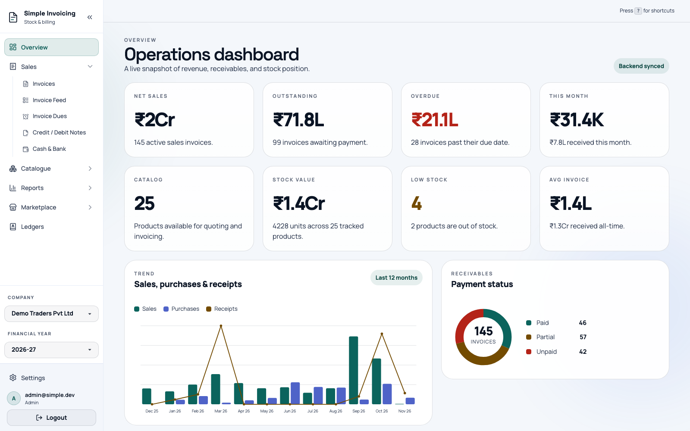
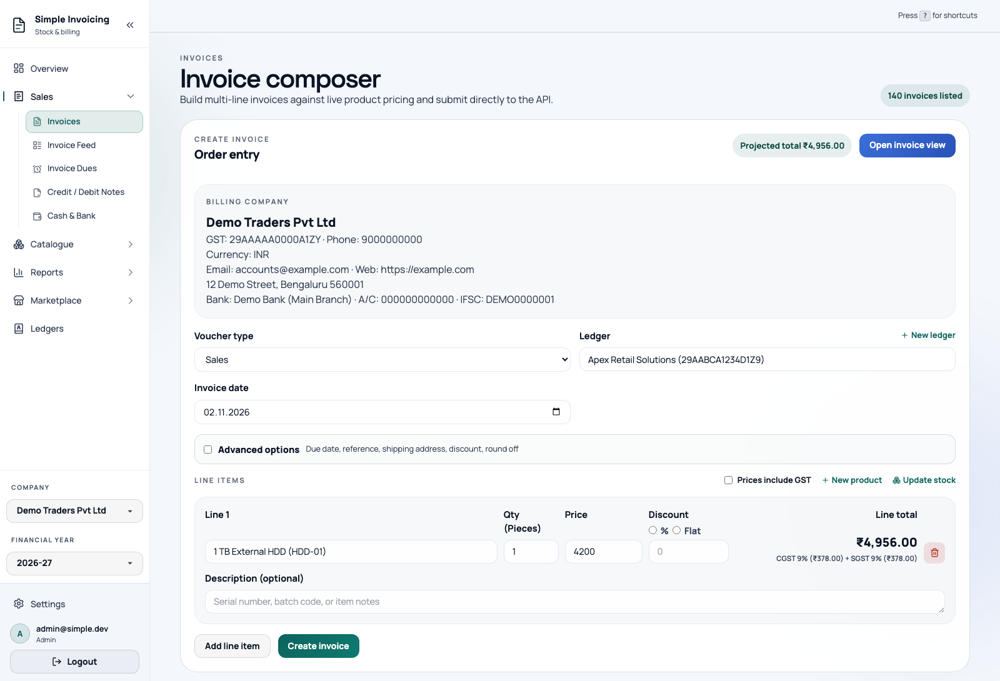
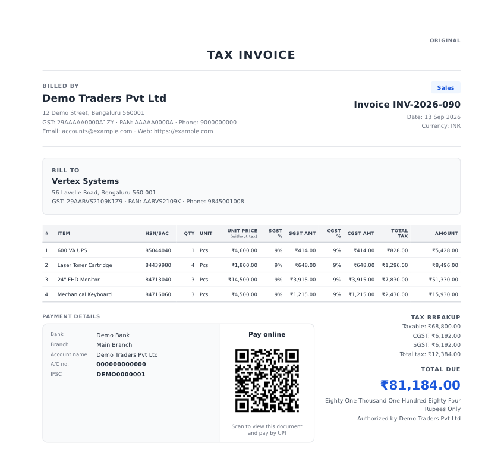
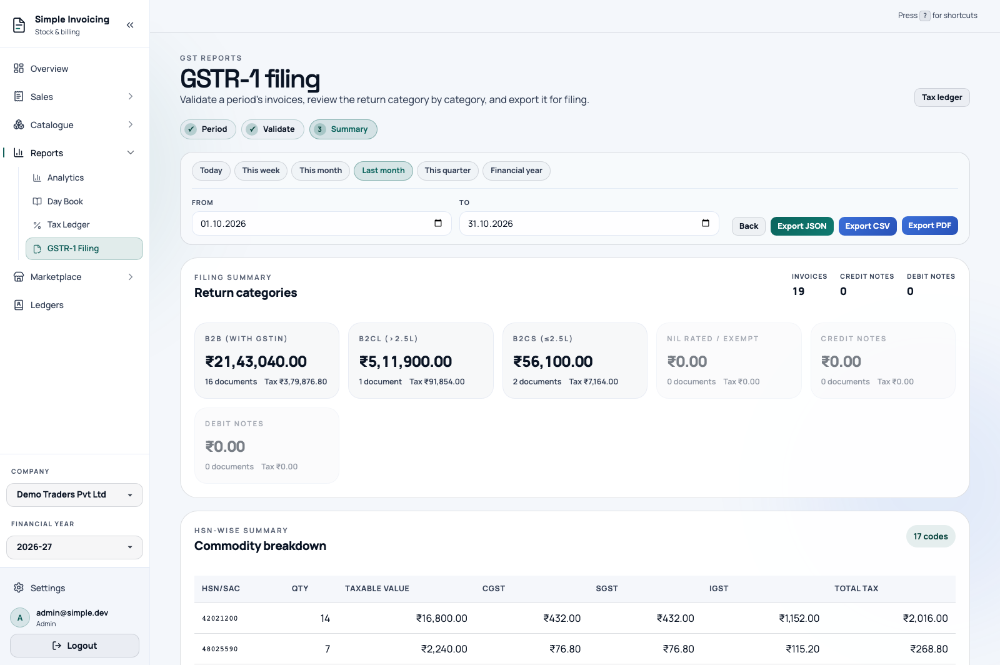
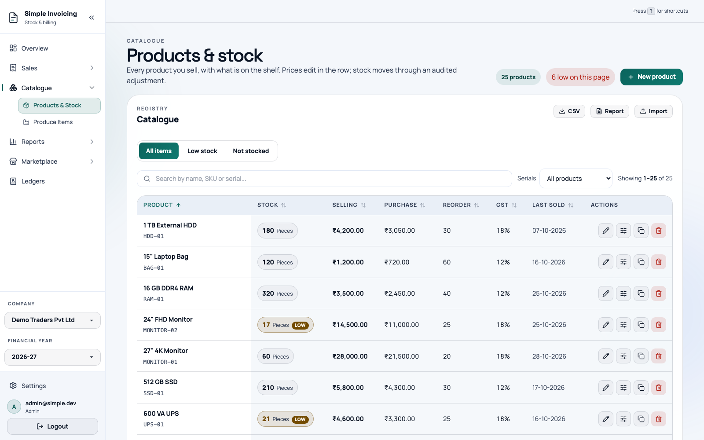
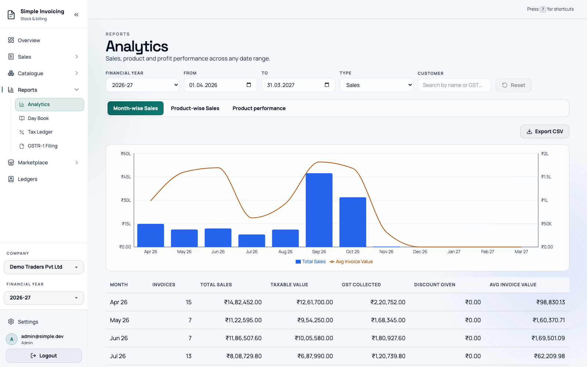

<div align="center">


# Simple Invoicing: Free GST Billing Software for India

**Open-source GST billing, invoicing and accounting software for Indian small businesses**

Make GST invoices, quotations, credit notes and e-way bills, and download them as PDF. Export your GSTR-1 JSON for the GST portal, and manage inventory, ledgers and UPI payments. It works in the browser on a laptop or phone, with staff logins for your team and [an MCP server](#connect-ai-assistants-mcp) for Claude, ChatGPT and other AI assistants.

A free, open-source **invoice maker** and **Tally alternative** for shops, traders, manufacturers, freelancers and service businesses.

**[Try the hosted app](https://app.simpleinvoicings.com/register)** (first month free, nothing to install) · **[Self-host it free](#quick-start)** · **[User guide](https://guide.simpleinvoicings.com)** · **[Website](https://simpleinvoicings.com)**

[](https://github.com/nikhilb2/simple-invoicing-free-gst-billing-software/stargazers)
[](LICENSE)
[](CONTRIBUTING.md)
[](https://fastapi.tiangolo.com/)
[](https://react.dev/)
[](https://www.postgresql.org/)

</div>

---

## Screenshots

These show a made-up demo business.

<table>
  <tr>
    <td width="50%"><br><sub><b>Dashboard</b>: sales, receivables, stock and trends at a glance.</sub></td>
    <td width="50%"><br><sub><b>Create invoices</b>: GST is worked out as you add each line.</sub></td>
  </tr>
  <tr>
    <td width="50%"><br><sub><b>PDF tax invoice</b>: HSN codes, tax breakup and a QR code to pay by UPI.</sub></td>
    <td width="50%"><br><sub><b>GSTR-1</b>: review each return category, then export JSON, CSV or PDF.</sub></td>
  </tr>
  <tr>
    <td width="50%"><br><sub><b>Products and stock</b>: prices, GST rates and low-stock alerts.</sub></td>
    <td width="50%"><br><sub><b>Analytics</b>: sales and GST by month, product and period.</sub></td>
  </tr>
</table>

## Features

### GST and billing

- **Sales and Purchase Invoices** — Automatic inventory effects, plus cancel, restore and duplicate
- **Quotations & Proforma Invoices** — Offers on their own number series with PDF and share links, converted to an invoice through the composer. No effect on stock, ledgers or returns until then
- **Credit Notes** — Issue credit notes against invoices with linked ledger and stock reversals
- **GSTR-1** — Validate a return and export it as JSON, CSV or PDF
- **GSTR-3B Worksheet** — Estimates your GSTR-3B figures from your books, including the IGST set-off order. It is a worksheet to check against, not a filing
- **E-Way Bill JSON** — Check an invoice and generate the file for the portal's bulk upload (from the E-Way Bill button on the invoice preview)
- **Tax Ledger** — Tax register with CSV and PDF export
- **GSTIN Validation** — Checks format, state code and check digit (this does not confirm registration on the GST portal)
- **PDF Invoices** — Generated with WeasyPrint, with your company logo and terms
- **Custom Invoice Numbering** — Configurable invoice series per financial year
- **Financial Years** — Period management for scoping vouchers and reports

### Getting paid

- **Payment Tracking** — Record payments against invoices, with PDF receipts, dues, a receivables ageing summary and overdue badges
- **Payment Reminders** — Email reminders and statements, or a ready-made WhatsApp reminder from the Invoice Dues list
- **Pay by UPI** — Optional QR on invoice PDFs that opens the invoice's share page, where the customer pays the live outstanding balance from any UPI app
- **Share Links** — Public links to documents and ledger statements, with WhatsApp sharing. See every live link for a customer and revoke any of them
- **Email Delivery** — Send invoices, ledger statements and payment reminders, with full email history

### Inventory and manufacturing

- **Inventory Management** — Real-time stock tracking with automatic adjustments
- **Serial Tracking** — Track individual units, and scan serial or SKU codes
- **Manufacturing / Bill of Materials** — Define BOMs and record production that consumes raw materials and produces finished goods
- **Product CSV Import and Export** — Move your catalogue in and out in bulk

### Accounting and reports

- **Ledger Statements** — Period-based financial views per account (Tally-style), with PDF and CSV export
- **Day Book Register** — Cross-ledger voucher register for reconciliation
- **Cash & Bank** — Manage cash and bank accounts with company-account mappings
- **Dashboard** — Monthly trend, payment-status and top-product charts
- **Analytics** — Monthly sales, sales by product, product performance, and profit and loss

### Teams and administration

- **Multiple Companies** — Run more than one company from one login
- **Role-Based Access** — Admin, Manager and Staff roles
- **Accounts** — Self sign-up on the hosted app, email verification, password reset and optional Google sign-in
- **Guided First Invoice** — New owners can follow a walkthrough that points at each field while they add a customer and a product and create their first invoice
- **Backups** — On-demand and nightly backups, with download and restore
- **Themes and Keyboard Shortcuts** — Light, dark or follow your device, and configurable shortcuts with a cheat sheet on `?`

### Integrations

- **REST API and API Keys** — Interactive docs at `/docs`
- **MCP Server** — Connect Claude, ChatGPT and other AI assistants to your books ([how to connect](#connect-ai-assistants-mcp))
- **Marketplace** — Optional B2B listings and orders through a central server. No money passes through it, so businesses settle directly with each other ([contract](MARKETPLACE.md))

## An open-source alternative to Tally, Vyapar, Zoho Invoice and myBillBook

Simple Invoicing covers the everyday work of a small GST-registered business: billing, stock, party ledgers and the GSTR-1 file. How it differs from the usual GST billing apps:

- **Open source (MIT).** Every line of code is here. You can read it, change it and run it yourself.
- **Free to self-host.** Run your own copy on your own server with Docker, with no licence fee and no limit on users or invoices. Or use the [hosted app](https://app.simpleinvoicings.com/register), where the first month is free.
- **No per-user pricing on the hosted plans.** Add staff with Admin, Manager or Staff roles at no extra cost per seat.
- **Works in the browser.** Use it on Windows, Mac, Linux, Android or iPhone. There is nothing to install on the hosted version.
- **Your data stays yours.** Export invoices, ledgers, products and reports as CSV, JSON or PDF at any time.
- **Built for AI assistants.** Ask Claude or ChatGPT about unpaid invoices, profit or stock through the built-in MCP server.

## Connect AI Assistants (MCP)

Simple Invoicing has a built-in [MCP](https://modelcontextprotocol.io/) server, so Claude, ChatGPT and other MCP clients can work with your invoices, ledgers, stock and reports. You can ask things like:

- "Which invoices are still unpaid?"
- "What was my profit last quarter?"
- "Show me the GSTR-1 summary for October."
- "How much stock do I have left of this product?"

**To connect:**

1. Add a custom connector in your AI assistant, using one of these URLs:
   - Hosted: `https://app.simpleinvoicings.com/mcp`
   - Your own copy: `https://<your-host>/mcp`
2. Sign in to Simple Invoicing and approve the access you want to give.
3. To review or revoke that access later, go to **Settings → Connected Apps**.

**If you run your own copy:**

- In production, set `PUBLIC_API_BASE_URL` and `PUBLIC_APP_BASE_URL` to your `https://` addresses. MCP stays off until you do.
- Tools that change data stay off until you set `MCP_WRITE_ENABLED=true`.
- Clients get a curated set of tools by default. Add `?profile=all` to the URL for all of them.

See [ENV.md](ENV.md) for every MCP setting.

## Tech Stack

| Layer | Technology |
|-------|-----------|
| **Backend** | Python 3.11, FastAPI 0.115, SQLAlchemy 2.0, Pydantic 2 |
| **Frontend** | React 18, TypeScript 5, Vite 5, Tailwind CSS 3, TanStack Query 5, Zustand, React Router 6, Recharts, Framer Motion |
| **Database** | PostgreSQL 16 |
| **Auth** | JWT with bcrypt password hashing, optional Google sign-in |
| **PDF** | WeasyPrint |
| **Email** | SMTP (per-company configuration) |
| **Analytics** | PostHog (optional; does nothing until `POSTHOG_PROJECT_API_KEY` is set) |
| **Testing** | Playwright (E2E), Vitest (frontend), pytest (backend), GitHub Actions (CI) |
| **Deploy** | Docker, Docker Compose, Kaniko build manifests |

## Quick Start

To use the app without installing anything, [create an account](https://app.simpleinvoicings.com/register) on the hosted version. The steps below are for running your own copy.

### Prerequisites

- [Docker](https://docs.docker.com/get-docker/) & Docker Compose
- Or: Python 3.11, Node.js 22+, PostgreSQL 16+

### Option 1: Docker (recommended)

```bash
# Clone the repository
git clone https://github.com/nikhilb2/simple-invoicing-free-gst-billing-software.git
cd simple-invoicing-free-gst-billing-software

# Copy environment files
cp .env.example .env
cp backend/.env.example backend/.env.development
cp frontend/.env.example frontend/.env.development

# Start development environment
make dev

# Seed the admin user
make seed
```

Database migrations run automatically when the backend starts.

The app will be available at:
- **Frontend**: http://localhost:5173
- **Backend API**: http://localhost:8000
- **API Docs (Swagger)**: http://localhost:8000/docs

### Option 2: Manual Setup

<details>
<summary>Click to expand manual setup instructions</summary>

WeasyPrint needs Pango and related system libraries. See [PDFGENERATION.md](PDFGENERATION.md) for how to install them.

**Backend:**

```bash
cd backend
python3 -m venv .venv
source .venv/bin/activate
pip install -r requirements.txt
cp .env.example .env.development
uvicorn app_main:app --reload --port 8000
```

**Frontend:**

```bash
cd frontend
npm install
cp .env.example .env.development
npm run dev
```

**Seed admin user:**

```bash
cd backend
python seed_admin.py
```

</details>

### Default Credentials

After seeding, log in with:
- **Email:** `admin@simple.dev`
- **Password:** `Admin@123`

> ⚠️ Change these immediately in production!

### Production

See [DOCKER.md](DOCKER.md) for running production with `make prod`, and [ENV.md](ENV.md) for all settings.

## Project Structure

```
simple-invoicing-free-gst-billing-software/
├── backend/                # FastAPI application
│   ├── src/
│   │   ├── api/routes/     # REST API endpoints (one module per resource)
│   │   ├── models/         # SQLAlchemy ORM models
│   │   ├── schemas/        # Pydantic request/response schemas
│   │   ├── services/       # Business logic layer
│   │   ├── mcp_server/     # MCP server
│   │   ├── db/             # Engine, session, and declarative base
│   │   └── core/           # Config and security
│   ├── migrations/         # Database migrations
│   ├── tests/              # pytest suite
│   ├── migrate.py          # Migration runner
│   ├── reset_db.py         # Reset the database schema
│   ├── seed_admin.py       # Seed the initial admin user
│   ├── seed_demo.py        # Seed demo data
│   └── requirements.txt
├── frontend/               # React SPA
│   ├── src/
│   │   ├── pages/          # Route-level components
│   │   ├── features/       # Feature modules (analytics, invoices, marketplace, serials and more)
│   │   ├── components/     # Shared UI components
│   │   ├── api/            # Axios client & interceptors
│   │   ├── hooks/          # Shared React hooks
│   │   ├── store/          # Zustand stores
│   │   ├── context/        # React context
│   │   └── types/          # TypeScript type definitions
│   ├── e2e/                # Playwright E2E tests
│   └── package.json
├── docs/screenshots/       # Screenshots
├── docker-compose.yml      # Multi-container orchestration
└── Makefile                # Developer shortcuts
```

## Documentation

| Guide | Covers |
|-------|--------|
| [CONTRIBUTING.md](CONTRIBUTING.md) | Local setup, tests and how to contribute |
| [DOCKER.md](DOCKER.md) | Docker guide |
| [ENV.md](ENV.md) | Environment variables |
| [MIGRATION.md](MIGRATION.md) | Migration workflow |
| [PDFGENERATION.md](PDFGENERATION.md) | PDF invoice generation |
| [CREDIT_NOTE.md](CREDIT_NOTE.md) | Credit note design |
| [CASH_BANK.md](CASH_BANK.md) | Cash & bank module |
| [INVOICE_DUE.md](INVOICE_DUE.md) | Invoice dues and receivables |
| [MARKETPLACE.md](MARKETPLACE.md) | Marketplace API contract |
| [SECURITY.md](SECURITY.md) | Security policy |
| [project.md](project.md) | Architecture and API context |

## API Overview

All routes sit under `/api`. Full interactive docs are at `/docs` (Swagger UI) when the backend is running.

| Prefix | Description |
|--------|-------------|
| `/api/auth` | Login, registration, email verification, password reset |
| `/api/users` | User management |
| `/api/api-keys` | API key management |
| `/api/company` | Company profiles, logo and terms |
| `/api/company-accounts` | Cash & bank and company accounts |
| `/api/products` | Product catalogue, CSV import and export |
| `/api/inventory` | Stock levels, adjustments and production |
| `/api/bom` | Bills of material |
| `/api/serials` | Serial-tracked units and code scanning |
| `/api/invoices` | Sales and purchase invoices, dues, PDF and export |
| `/api/credit-notes` | Credit notes |
| `/api/quotations` | Quotations and proforma invoices |
| `/api/payments` | Payments and receipts |
| `/api/ledgers` | Ledgers, statements, day book, tax ledger, GSTR-1 and the GSTR-3B worksheet (an estimate, not a filing) |
| `/api/invoice-series` | Invoice numbering series |
| `/api/financial-years` | Financial year management |
| `/api/dashboard` | Dashboard metrics and chart data |
| `/api/analytics` | Sales, product performance, and profit and loss reports |
| `/api/email` | Send invoices, statements and reminders |
| `/api/email-logs` | Email delivery history |
| `/api/smtp-configs` | Per-company SMTP configuration |
| `/api/share` | Public share links |
| `/api/shortcuts` | Keyboard shortcuts |
| `/api/backups` | Create, schedule, download and restore backups |
| `/api/marketplace` | Marketplace listings and orders |

The MCP endpoint is at `/mcp`, and its OAuth server is at `/api/oauth`.

## Development

```bash
make dev                              # Start dev environment (Docker)
make prod                             # Start production environment
make build                            # Build the dev Docker images
make install                          # Install backend and frontend dependencies
make test                             # Run the Playwright E2E suite
make test-unit                        # Run frontend Vitest unit tests (single run)
make test-backend                     # Run backend pytest suite (needs Postgres)
make test-all                         # Run test-unit, test-backend and test
make lint                             # Compile-check backend Python and build frontend
make migrate                          # Run all pending migrations
make migrate-status                   # Show migration status
make migrate-down                     # Roll back last migration
make migrate-down-all                 # Roll back all migrations
make migrate-create name=<name>       # Create a new migration file
make seed                             # Seed admin user
make seed-demo                        # Seed demo data
make reset-db                         # Reset DB schema, migrate, and seed admin
make reset-db-demo                    # Reset DB and seed with demo data
make backend-shell                    # Open a shell in the backend container
make frontend-shell                   # Open a shell in the frontend container
make logs                             # Tail all service logs
make down                             # Stop all services
```

See the [Makefile](Makefile) for all available commands.

## Roadmap

**Shipped recently**

- [x] Quotations and proforma invoices
- [x] E-way bill JSON for the portal's bulk upload
- [x] GSTR-3B worksheet, estimated from your books
- [x] Self sign-up and Google sign-in on the hosted app
- [x] A guided walkthrough to your first invoice
- [x] Light, dark and follow-your-device themes
- [x] Layouts that work on a phone
- [x] Email delivery, dashboard charts and CSV export

**Next**

- [ ] Recurring invoices
- [ ] An audit log of who changed what
- [ ] Excel (.xlsx) export
- [ ] Invoices in foreign currencies
- [ ] Balance sheet

Want to work on one of these, or something else? Open an issue to talk it through, or go straight to a PR. You don't need to ask first or be assigned. Issues labelled **good first issue** are a good place to start, and [#532](https://github.com/nikhilb2/simple-invoicing-free-gst-billing-software/issues/532) explains how to report a bug or suggest an idea.

## FAQ

**Is Simple Invoicing free?**
Yes, to self-host. The software is open source under the MIT licence, so you can run your own copy free, for any number of users and invoices. The [hosted version](https://app.simpleinvoicings.com/register) is free for the first month, with no credit card needed, and then paid plans start at Rs 299 a month.

**Can I make GST invoices in PDF?**
Yes. Each tax invoice shows HSN/SAC codes, the CGST, SGST or IGST breakup, your logo, bank details and an optional pay-by-UPI QR code. You can download the PDF, email it or share it on WhatsApp.

**Does it file GSTR-1 for me?**
No. It checks your sales for the period and produces the GSTR-1 JSON file, which you upload on the GST portal. It also estimates your GSTR-3B figures from your books. See the guide to [GSTR-1 filing](https://guide.simpleinvoicings.com/reports/gstr1).

**Can I use it as a Tally alternative?**
For billing, stock, party ledgers, the day book and GST returns, yes. It runs in the browser, so your team can work from any device. It does not yet do payroll, multi-currency or a full balance sheet.

**Does it work on a mobile phone?**
Yes. It runs in the phone's browser, so there is no app to install.

**Can I import my products?**
Yes. Products and stock import and export as CSV.

More answers are in the [user guide](https://guide.simpleinvoicings.com) and its [troubleshooting page](https://guide.simpleinvoicings.com/help/faq).

## Contributing

We welcome contributions of all kinds! Whether it's bug fixes, new features, documentation, or tests — every contribution matters.

Please read our [Contributing Guide](CONTRIBUTING.md) to get started. Open the repository Issues tab for ideas on where to begin.

## License

This project is licensed under the MIT License — see the [LICENSE](LICENSE) file for details.

## Acknowledgments

Inspired by [Tally](https://tallysolutions.com/) accounting software. Built with FastAPI, React, and PostgreSQL.

Special thanks to [Nash Aschenbath](https://github.com/Aschenbath) for the live GSTR-1 number limits in the invoice series form (#545).
